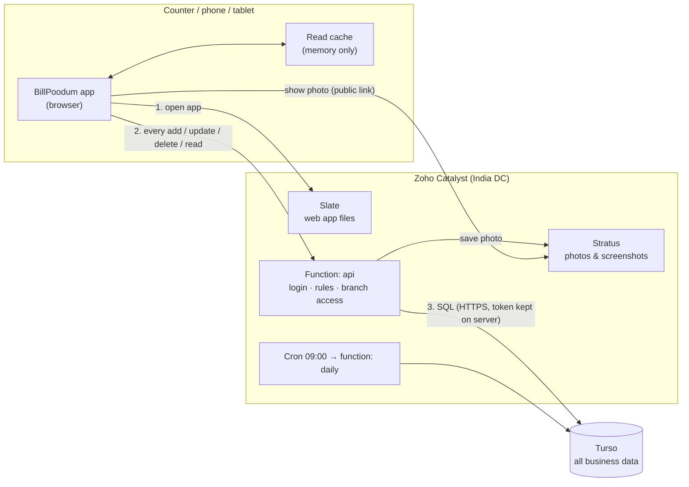
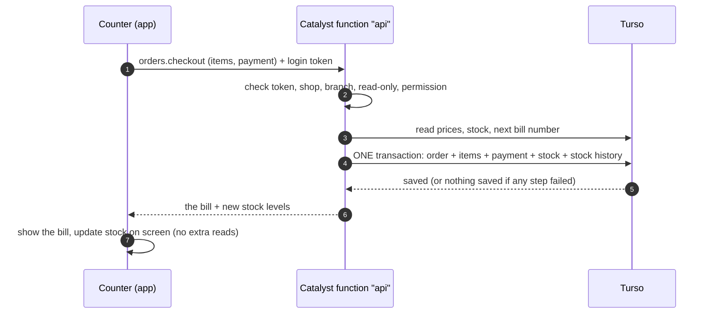
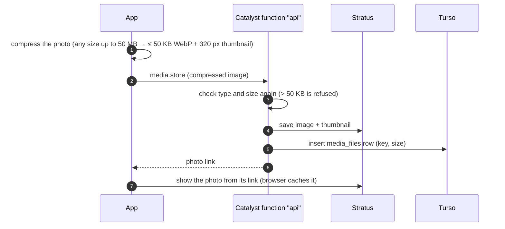

# BillPoodum on Catalyst + Turso — how it works and what it costs

Prices below were read from the official pricing pages on **12 Oct 2026**
([Catalyst](https://catalyst.zoho.com/pricing.html) pay-as-you-go calculator, [Turso](https://turso.tech/pricing)).
They change — check the pages before deciding. Usage numbers (bills, calls, sizes) are **estimates**.

---

## 1. Who does what

| Part | Runs on | Stores |
|---|---|---|
| Web app (React screens) | **Catalyst Slate** (CDN hosting) | the built app files only |
| API (`api` function, 149 actions) | **Catalyst Functions** (Advanced I/O, Node.js) | nothing — it only checks and passes data |
| Daily renewal reminders (`daily`) | **Catalyst Cron** + Functions | nothing |
| Product photos, ticket screenshots | **Catalyst Stratus** (file storage) | image files (≤ 50 KB each, + 320 px thumbnail) |
| **All business data** — shops, users, products, bills, stock, payments, staff, tickets… | **Turso** (SQLite, managed): 1 platform database + 1 database per shop | every table in `schema.sql` ([TURSO.md](TURSO.md)) |

The Catalyst **Data Store is not used** in this setup. No business data is kept in Catalyst — only the photo files.

**The browser never talks to Turso.** Only the Catalyst function has the Turso token, so a customer can't read
another shop's data by changing a request.

---

## 2. A bill, step by step

- All the writes of a bill happen in **one Turso transaction**: either everything is saved, or nothing is.
  (The Catalyst Data Store has no transactions — that's why the Catalyst-only version needs retries.)
- The screen changes only after the server says "saved". Nothing is queued when offline.

## 3. A photo, step by step

## 4. How the two are joined

| Where | What |
|---|---|
| Catalyst function settings (environment variables) | `TURSO_PLATFORM_URL`, `TURSO_AUTH_TOKEN` (group token), `TURSO_ORG`, `TURSO_API_TOKEN`, `TURSO_GROUP`, `SECRETS_KEY` (+ `AUTH_SECRET`, `SETUP_KEY`, `STRATUS_BUCKET`, `STRATUS_PUBLIC_URL`, `ALLOWED_ORIGINS`) — DEPLOY.md step 6 |
| Backend code | `TursoDb` — the same `Db` interface as the Catalyst version (`backend/src/db/`), over HTTPS with plain `fetch`. All actions, rules, app screens and tests are shared. |
| Tables | Made by the API: migrations in `backend/migrations/` run on the platform database at the first request and on each shop's database when it is created. New columns later = a new migration file. |
| Region | The Turso group in the region nearest to Catalyst's India data centre, so each query is fast. |
| Session cache | Not Catalyst Cache: the function's memory + a small "epoch" read per request (TURSO.md §3). |

---

## 5. Prices

### 5.1 Catalyst (pay-as-you-go, after the free tier)

Free tier: **₹300 of credits every month**, and the free amounts below. A project that goes past the free tier has a
**minimum bill of ₹300 / month**. Subscription plans start at **Lite ₹600 / month**. New accounts get ₹15,000 trial
credits for 6 months.

| What we use | Free / month | Price after that | Used for |
|---|---|---|---|
| Functions | 25,000 GB-seconds | ₹0.00096 per GB-second | every API call (`api`) and the daily job |
| API requests | 100,000 | ₹0.00006 per request | calls coming into the function |
| Slate — CDN & origin requests | 300,000 | ₹0.00024 per request | loading the app files |
| Slate — CDN storage | 500 MB | ₹0.006 per MB | the built app (~3 MB) |
| Slate — build & deploy | 12 GB-minutes | ₹0.6 per GB-minute | only when you deploy |
| Stratus — storage | 5 GB | ₹1.2 per GB | photos |
| Stratus — uploads | 1,000 | ₹0.0003 per upload | new photos / screenshots |
| Stratus — downloads | 10,000 | ₹0.000024 per download | showing photos |
| Cron | (part of Functions) | — | daily reminders |
| Data Store | *not used* | (INSERT ₹0.006, UPDATE ₹0.0048, SELECT ₹0.0036 each) | — |

So: **hosting (Slate) and function calls are billed separately**, each with its own free amount, but they come out
of the same monthly Catalyst bill.

### 5.2 Turso

| Plan | Price / month | Storage | Rows read | Rows written | Over the limit |
|---|---|---|---|---|---|
| Free | $0 | 5 GB | 500 million | 10 million | — |
| Developer | $4.99 (~₹420) | 9 GB | 2.5 billion | 25 million | $0.75/GB, $1/billion reads, $1/million writes |
| Scaler | $24.92 (~₹2,100) | 24 GB | 100 billion | 100 million | $0.50/GB, $0.80/billion reads, $0.80/million writes |

"Rows read" counts rows a query **scans** — good indexes keep it low (they are part of the schema file).

---

## 6. What one shop uses (estimate)

| | Small (tea shop / hotel / salon) | Medium (restaurant / retail) | Supermarket |
|---|---|---|---|
| Bills / day × items | 100 × 4 | 200 × 6 | 500 × 15 |
| API calls / month | ~6,000 | ~20,000 | ~60,000 |
| Function time (~0.1 GB-s per call) | ~600 GB-s | ~2,000 GB-s | ~6,000 GB-s |
| Turso rows written / month | ~20,000 | ~80,000 | ~3.3 lakh |
| Turso data added / month | ~25 MB | ~80 MB | ~250 MB |
| Photos (Stratus) | ~10 MB | ~50 MB | ~250 MB |

## 7. Monthly bill — examples

**A. Testing, up to ~5 small shops** — everything inside the free tiers: **₹0**.

**B. 50 small + 10 medium + 5 supermarkets**

| Item | Usage | Cost |
|---|---|---|
| Catalyst Functions | ~80,000 GB-s (25,000 free) | ~₹53 |
| Catalyst API requests | ~8 lakh (1 lakh free) | ~₹42 |
| Slate requests | ~10 lakh (3 lakh free) | ~₹168 |
| Stratus | ~6.5 GB stored, ~20 lakh downloads | ~₹50 |
| **Catalyst total** | | **~₹313** (the ₹300 free credits cover most of it; minimum bill ₹300 once past free) |
| Turso | ~35 lakh writes (free: 1 crore) · storage grows ~3.3 GB / month | Free for the first month, then **Developer $4.99**; after ~a year of data **Scaler ~$25–35** |
| **Total** | | **~₹300 – ₹3,000 / month** (mostly Turso storage as data grows) |

**Same 65 shops on the Catalyst Data Store only** (no Turso): ~₹5,000 per supermarket and ~₹1,500 per medium shop
per month in Data Store inserts/updates/selects alone → **~₹50,000 / month**. That's why Turso is used for the data.

Keeping Turso storage low: move old stock history (older than 1–2 years) to a file archive; bills and reports stay.

---

## 8. Catalyst only vs Catalyst + Turso

| | Catalyst only (built) | Catalyst + Turso (next) |
|---|---|---|
| Business data | Catalyst Data Store | Turso |
| Photos, hosting, functions, cron | Catalyst | Catalyst |
| Cost per bill | ₹ per row written / read | almost nothing until plan limits |
| Transactions | No (retries / undo in code) | **Yes** — a bill is saved fully or not at all |
| Creating tables | 57 tables by hand in the console | one SQL command |
| Query limits | 300 rows / query, 4 joins | normal SQL |
| Local tests | in-memory imitation | the real SQLite engine |
| Vendors / bills | 1 | 2 (Catalyst + Turso) |
| Risk | — | Turso is joining Supabase — pricing may change; data is plain SQLite and easy to move |

## 9. Status

Built (see [TURSO.md](TURSO.md)): `TursoDb` with transactions, one database per shop, migrations, bills/stock/returns
in one transaction each, the change feed, sessions in function memory, encrypted secrets, tests on real SQLite (in
process and over HTTP), the deploy guide and the smoke test. Screens, actions and business rules are unchanged.
