# BillPoodum — Tables & Relations

A guide to [`schema.sql`](schema.sql): what each table is for and how the tables connect.
59 tables in 10 groups.

> **Where the tables live (Turso: one platform database + one database per shop).** Platform database: `platform_admins`,
> `platform_settings`, `plans`, `feature_flags`, `feature_flag_businesses`, `businesses` (the shop directory),
> `subscription_periods`, `admin_audit_logs`, `support_tickets`, `ticket_messages`, `ticket_attachments`, `login_names`,
> `shop_databases`. In both (shop rows in the shop's, platform rows in the platform's): `media_files`, `secrets`,
> `whatsapp_templates`, `whatsapp_messages`. Every other table is in each shop's own database. A relation between the
> two databases is kept by the API, not by a foreign key. Source: [`backend/scripts/placement.mjs`](../../backend/scripts/placement.mjs),
> details in [TURSO.md](TURSO.md). On the Catalyst Data Store all tables are in one place. Fixed lists (status, kind, method…) are stored as numbers — see [`enums.ts`](enums.ts).

> **How to read the diagrams**
> `A ||--o{ B` = one **A** has many **B** (B has a column pointing to A).
> `A ||--o| B` = one **A** has zero or one **B**.
> Every table also has Catalyst's own `ROWID` (primary key), `CREATORID`, `CREATEDTIME`, `MODIFIEDTIME`.

---

## 0. The big picture

One **business** (a customer shop) owns everything below it. Deleting a business deletes all its rows
(foreign keys with *Cascade*). The **platform** group is BillPoodum's own data, used by the product admin.

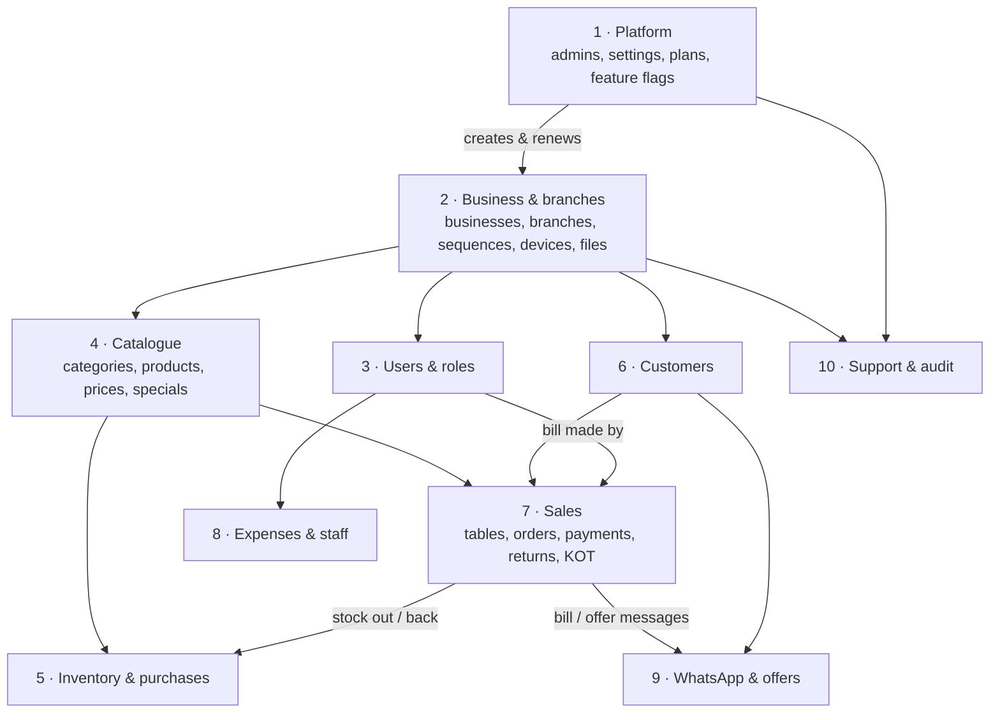

**One bill, end to end:**

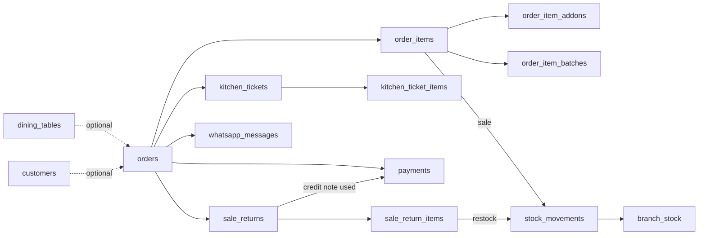

---

## 1. Platform (product admin)

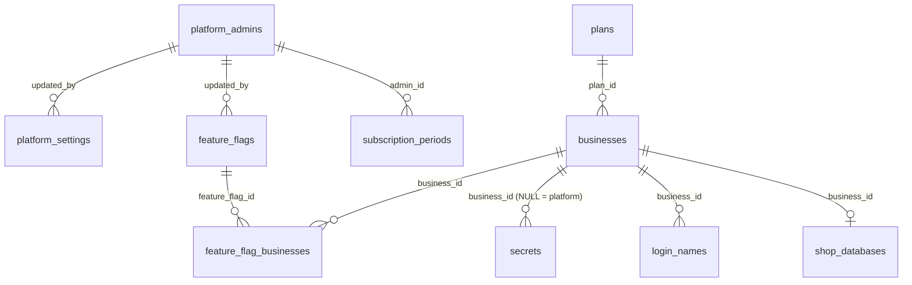

| Table | What it is for | Example |
|---|---|---|
| `platform_admins` | People who run BillPoodum: super / manager / support. Their own login (password hash, lock after wrong tries). | "Arun (Support)", role 3 |
| `platform_settings` | One row per platform setting, value as JSON. `pricing`, `reminders` (days before, support number, `lastRunOn` so the 9 AM job runs once a day), `whatsapp` (BillPoodum's own number). | key `reminders` |
| `secrets` | Tokens that must never reach a browser — encrypted. The customer's WhatsApp token and the platform's own token. | `whatsapp_token` |
| `plans` | What we sell: price per branch per month. Lets pricing change without code. | Standard, ₹499 |
| `feature_flags` | New features released step by step: off / selected customers / all. | `whatsapp` = selected |
| `feature_flag_businesses` | Which customers get a feature when its rollout is "selected". | WhatsApp → FreshMart |
| `login_names` | Every sign-in name (username, mobile, email) → its shop and user. Keeps them unique across all shops and lets sign-in find the shop's database. | `+919876543210` → shop 12, user 3 |
| `shop_databases` | Where each shop's own database is (Turso), its newest migration and state (creating / ready / failed / deleting). | `bp-shop-12`, ready |

---

## 2. Business & branches

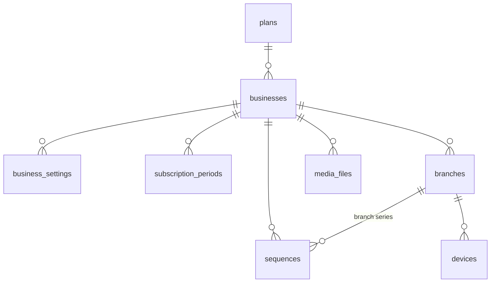

| Table | What it is for | Example |
|---|---|---|
| `businesses` | **The customer shop.** Name, category + sub type (Supermarket, Fast Food…), country, currency, GSTIN, logo, and the account state set by the admin: active / deactivated, plan end date (after it → read-only), branch limit, admin note. | Food Corner, valid till 14 Nov, 3 branches |
| `business_settings` | The shop's settings as JSON, one row each: `billing` (prefixes, tax mode, payment methods, round-off…), `terminology` (Menu Item vs Product), `modules` (which screens are on), `qr`, `wholesale`. New options need no new column. | key `billing` |
| `subscription_periods` | **History** of the plan: every new / renew / extend / branch change with months, branches, rate and amount, and which admin did it. (`businesses` keeps only the current end date and limit.) | Renew 6 months, ₹2,994 |
| `branches` | Shop locations. Own bill prefix (AD-, VL-), own GSTIN if in another state, open / closed, and the branch's **printer setup**. | T. Nagar, Adyar |
| `sequences` | Number counters so numbers never repeat: bill, order, KOT, credit note, purchase — per business or per branch, optionally restarting every financial year. | INV- next 11187 |
| `devices` | Each counter / waiter phone / kitchen screen of a branch, when it was last seen and last synced. For offline sync later. | Counter 1, T. Nagar |
| `media_files` | Facts about files kept in **Stratus**: product and category photos, logo, ticket screenshots, offer posters. Only the Stratus key and size are stored here. | `biz12/products/ab.webp`, 41 KB |

---

## 3. Users, roles & permissions

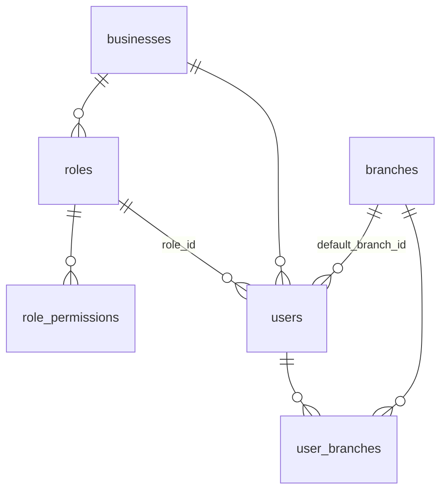

| Table | What it is for | Example |
|---|---|---|
| `roles` | Roles in a shop: Owner, Manager, Cashier, Waiter, Kitchen, or a custom one. Owner = all access. | Cashier |
| `role_permissions` | What a role may do, one row per permission. | Cashier → `billing.create` |
| `users` | Everyone who signs in to a shop: the owner (login created by the product admin) and staff. Mobile number (login ID), username, password hash, language, lock after wrong tries, `token_version` (raise it to sign the user out everywhere). Also staff pay: monthly / daily, amount, commission %. | Ravi, Cashier, ₹15,000 / month, 1% |
| `user_branches` | Which branches a staff member may work in (owners don't need rows). | Ravi → T. Nagar, Adyar |

---

## 4. Catalogue (products / menu)

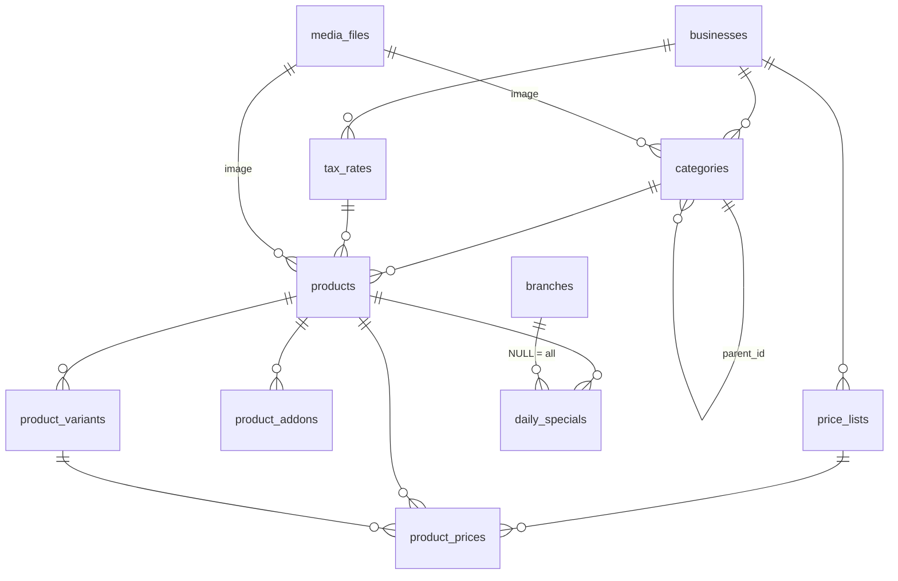

| Table | What it is for | Example |
|---|---|---|
| `tax_rates` | GST rates the shop uses, inclusive or exclusive. | GST 5% |
| `categories` | Groups shown as chips in billing. Emoji or photo. Sub-categories later (`parent_id`). | Burgers 🍔 |
| `products` | **Items sold** (goods or service): name, Tamil name, barcode, SKU, unit, price, MRP, cost, tax, veg flag, send to kitchen, track stock, batch & expiry on/off, low-stock level, photo. | Chicken Burger ₹120 |
| `product_variants` | Sizes of an item, each with its own price and barcode. | Half ₹120 / Full ₹200 |
| `product_addons` | Extras added to an item. | Extra cheese +₹20 |
| `price_lists` | Extra price lists besides retail. | Contractor rate |
| `product_prices` | An item's (or size's) price on a non-retail list. No row → retail price. | Switch 6A: ₹48 on Contractor |
| `daily_specials` | Today's specials: offer price and tag for a date, for one branch or all. | 11 Oct · Biryani ₹149 "Chef's pick" |

---

## 5. Inventory & purchases

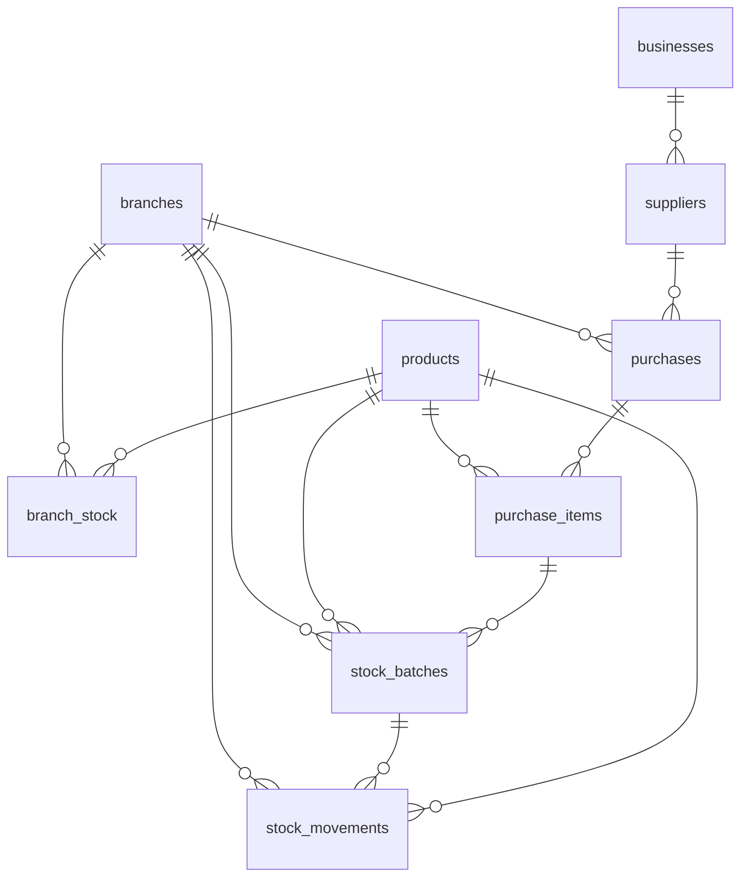

| Table | What it is for | Example |
|---|---|---|
| `branch_stock` | **Current stock** of each item in each branch — quick to read. | Milk 500 ml @ T. Nagar: 42 |
| `stock_movements` | **Every stock change** with the reason and the balance after it: opening, purchase, sale, return, wastage, damage, expired, adjustment, transfer. The history `branch_stock` comes from. | Sale −2, balance 40, bill INV-11186 |
| `stock_batches` | Stock kept by batch with an expiry date (milk, bread, medicines). Sold first-expiry-first-out. | Batch B12, expires 14 Oct, 18 left |
| `suppliers` | Who the shop buys from. *(Future — not in the app yet.)* | Aavin Dairy |
| `purchases` | Purchase / stock-in bill from a supplier. *(Future.)* | PUR-001, ₹8,400 |
| `purchase_items` | Lines of a purchase: item, qty, cost, batch, expiry. *(Future.)* | Milk × 100 @ ₹24 |

---

## 6. Customers

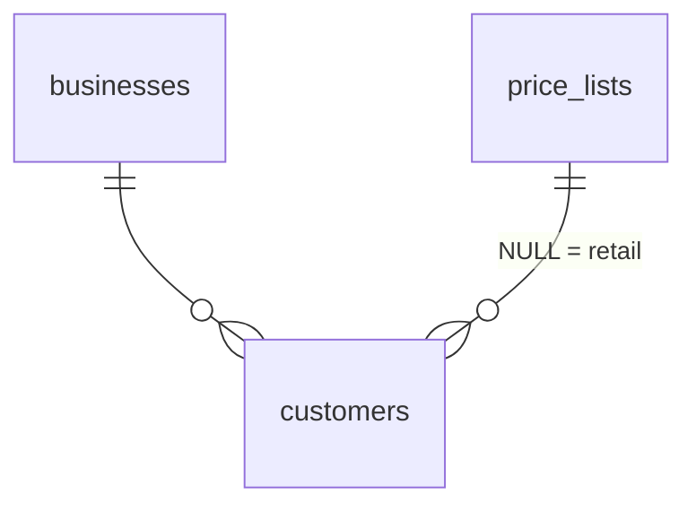

| Table | What it is for | Example |
|---|---|---|
| `customers` | The shop's buyers / guests: name, mobile, address, GSTIN, price list (contractor rate), credit limit, OK to get offers on WhatsApp. Outstanding due is worked out from their bills. | Raja Electricals, Contractor rate |

---

## 7. Sales — tables, orders, bills, payments, returns, kitchen

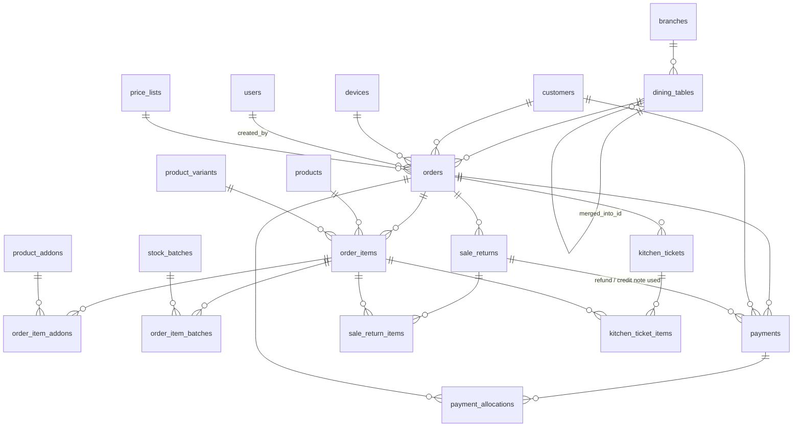

| Table | What it is for | Example |
|---|---|---|
| `dining_tables` | Restaurant tables of a branch: label, area, seats, QR link, merged into another table. | T5, Patio, 4 seats |
| `orders` | **An order that becomes a bill.** Type (dine-in, takeaway, delivery, counter), source (POS, waiter phone, table, QR), status (open → completed / cancelled), customer or walk-in name / phone / address, QR accept status, supermarket order stage (new → packing → ready → delivered), all totals, due, returned amount, GST break-up, who billed it. `invoice_number` is given when completed. | #2209 → INV-11186, ₹247 |
| `order_items` | Lines of a bill with a **copy** of name, size, unit, price, tax and cost at that moment (old bills never change when a product is edited). `kot_qty_milli` = qty already sent to the kitchen. | 2 × Chicken Burger ₹150 |
| `order_item_addons` | Add-ons picked for a line, with their price then. | + Cheese ₹20 |
| `order_item_batches` | Which batch a sold line came from, so a return goes back to the same batch. | Milk ×2 from B12 |
| `payments` | **Every money movement**: sale payment, due collected later, refund. Method cash / UPI / card / bank / credit note. Never edited — a mistake is voided and entered again. | ₹247 UPI |
| `payment_allocations` | One due payment spread over several old bills. *(Future.)* | ₹1,000 → INV-10 ₹600 + INV-14 ₹400 |
| `sale_returns` | **A return against a bill = a credit note** (CN-1001): reason, refund / exchange / keep as credit, how much reduced the due, refunded, credit issued and credit still left. | CN-1003, ₹290 credit |
| `sale_return_items` | Returned lines: qty, value, back to stock or damaged. | 1 × Parotta ₹26, restock |
| `kitchen_tickets` | **KOT** sent to the kitchen screen / printer: number, order, table, status (new → preparing → ready → completed), times. One order can have several KOTs (items added later). | KOT-0014, Table 5, Preparing |
| `kitchen_ticket_items` | Items on that KOT only, with qty, veg mark and note. | 2 × Masala Dosa "less oil" |

---

## 8. Expenses & staff

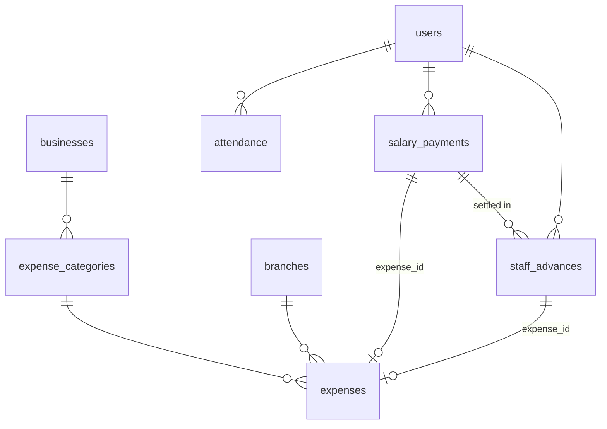

| Table | What it is for | Example |
|---|---|---|
| `expense_categories` | Expense heads: Purchase, Salary, Rent, Electricity, Transport, Maintenance, Other, or custom. | Rent |
| `expenses` | Money spent by the branch. Salary and advances also land here, so the day's report is right. | Rent ₹25,000 bank |
| `attendance` | One row per staff per day: present / half day / absent / leave, in / out time. | Ravi, 10 Oct, Present 09:30 |
| `salary_payments` | Salary paid for a month with **how it was worked out** (days, rate, commission on sales, bonus, deductions, advances) so the slip reprints exactly. One per person per month (no double pay). | Ravi Oct: ₹13,609.75 |
| `staff_advances` | Money given before salary day. Open until a salary takes it back (`salary_payment_id`). | Ravi ₹2,000 on 12 Oct |

---

## 9. WhatsApp & offers

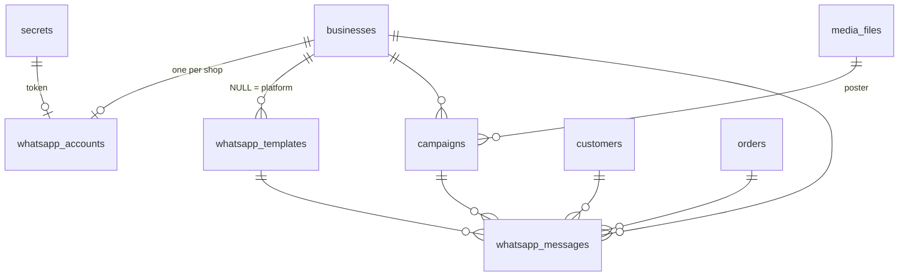

| Table | What it is for | Example |
|---|---|---|
| `whatsapp_accounts` | The shop's own WhatsApp Business (Meta Cloud API) connection: number, IDs, verified name, quality, auto-send bill on/off. Token is in `secrets`. | +91 98765 43210, Connected |
| `whatsapp_templates` | Message templates approved by Meta: the shop's **bill** and **offer** templates, and the platform's **renewal reminder** (`business_id` empty). | Bill, Tamil, Approved |
| `campaigns` | One "send offer" run: message, items, poster, how many sent. | "Diwali sweets 10% off", 120 sent |
| `whatsapp_messages` | **Every WhatsApp sent**: bills, offers, tests, and renewal reminders from BillPoodum to shop owners. Status sent → delivered → read / failed comes from Meta. Also the renewal reminder history. | INV-11186 → +91…, Read |

---

## 10. Support & audit

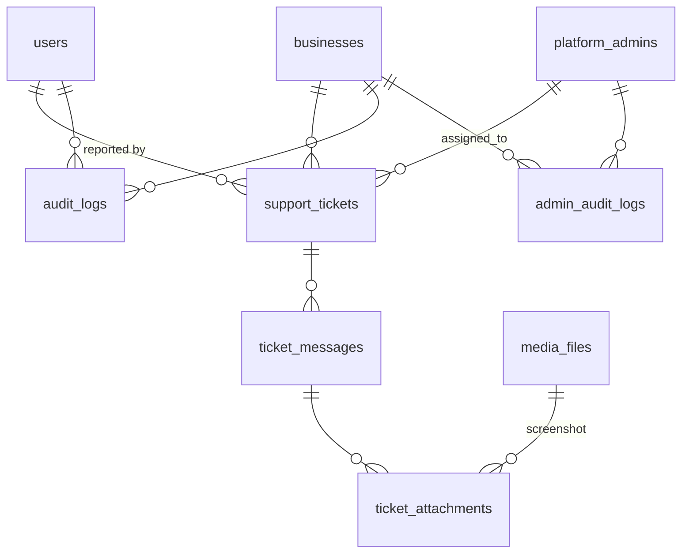

| Table | What it is for | Example |
|---|---|---|
| `support_tickets` | A problem reported from the app (Help & support): subject, category, urgency, status, assigned admin, page / browser / app version, unread flags. | T-1004 "Bill not printing" |
| `ticket_messages` | The conversation on a ticket, customer and admin. | "Please restart the printer…" |
| `ticket_attachments` | Screenshots on a message (files in Stratus). | 1024 × 768, 58 KB |
| `audit_logs` | What the shop's people did (Settings → Audit log): bill cancel, price change, printer change, import… Also marks changes made during an admin support view. | Ravi cancelled #2201 |
| `admin_audit_logs` | What the product admin team did: create customer, renew, reset password, support view, export, delete… Keeps the business name even after the customer is deleted. | Arun renewed FreshMart |

---

## Things that are NOT tables (by design)

| Need | Where it is handled |
|---|---|
| Errors, slow API calls, API counts | Catalyst DevOps — APM, Logs, Metrics |
| Renewal reminder log | `whatsapp_messages` (kind = renewal_reminder) + `platform_settings.reminders.lastRunOn` |
| Data export (Excel / ZIP) | One button, built straight away; who exported → audit logs |
| CSV import jobs | One click; the summary goes to `audit_logs` (action = import) |
| Printer pairing on a device | The browser of that device (only the setup is in `branches.printer_json`) |
| Outstanding due, stock value, reports | Worked out from `orders`, `payments`, `branch_stock`… (OLAP for big reports) |

## Rules that apply to every table

1. **Business first** — every shop table has `business_id`; the backend always filters by the signed-in user's business and checks branch access.
2. **Money in paise** (`*_minor`), qty in thousandths (`*_milli`), % in basis points (`*_bp`).
3. **Fixed lists are numbers** from `enums.ts` — never renumber; add new values at the end.
4. **Copies on bills** (`*_name`, prices) keep old bills correct after edits.
5. **No hard delete** of business records — `is_active`, `is_voided`, `deleted_at`.
6. **`client_uuid`** on bills, payments, KOTs and returns — a re-sent request never makes a duplicate.
7. **`row_version`** on rows several counters edit — one update can't silently overwrite another.
