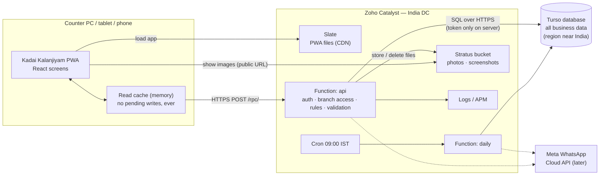
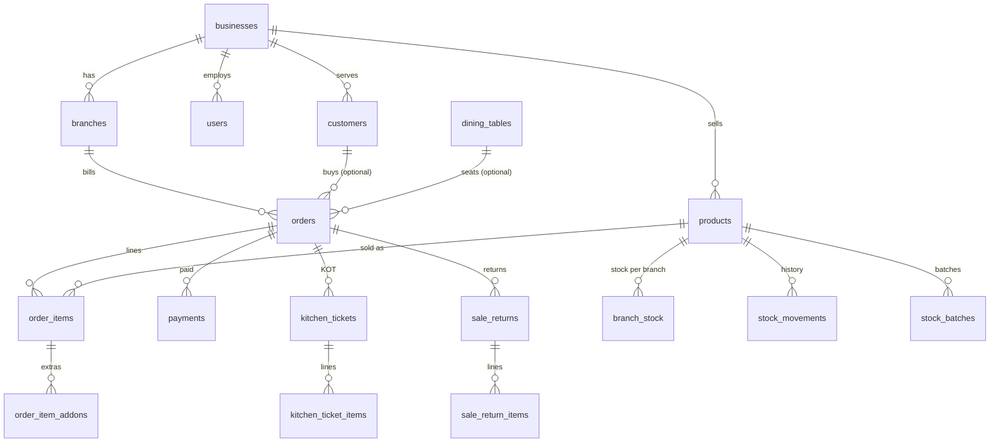
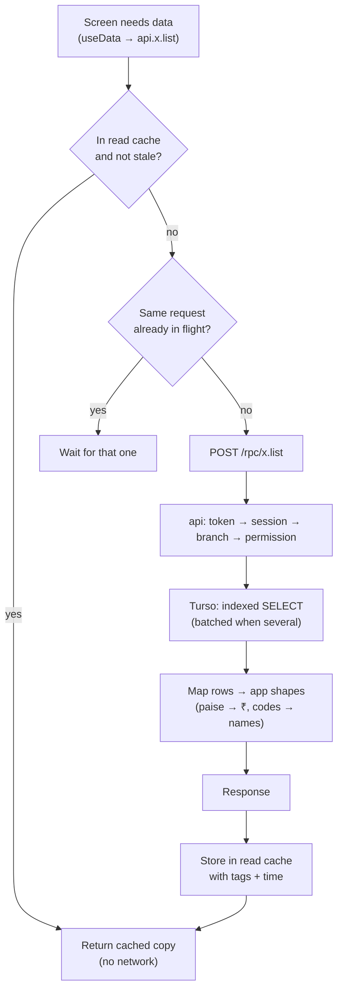
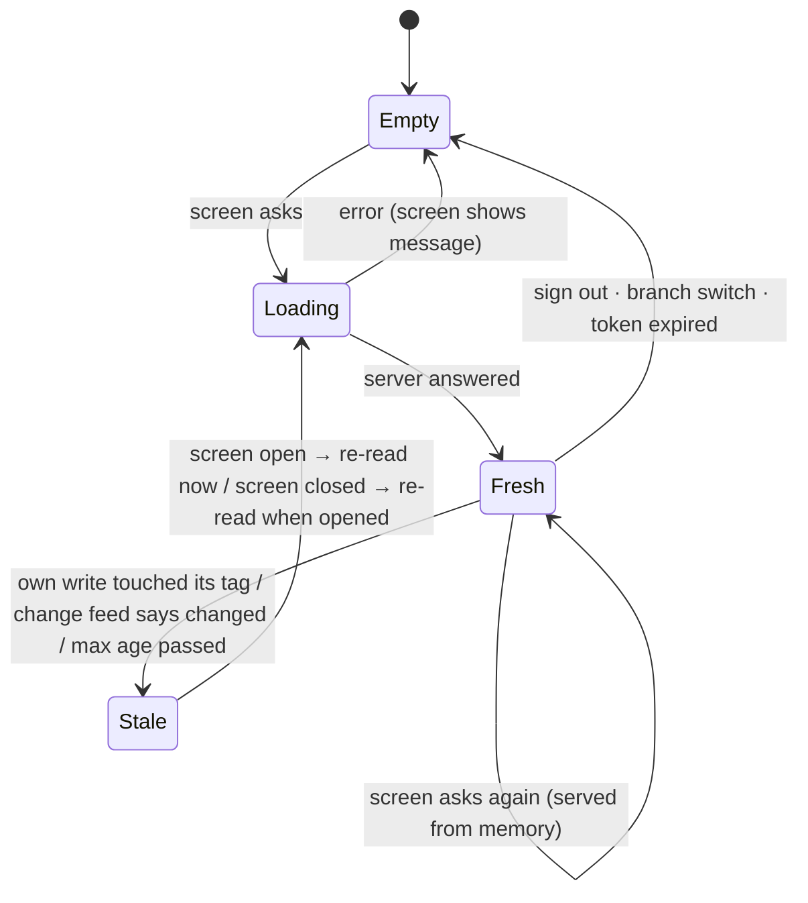
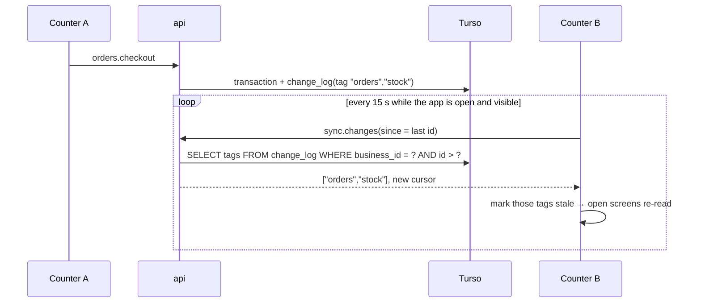
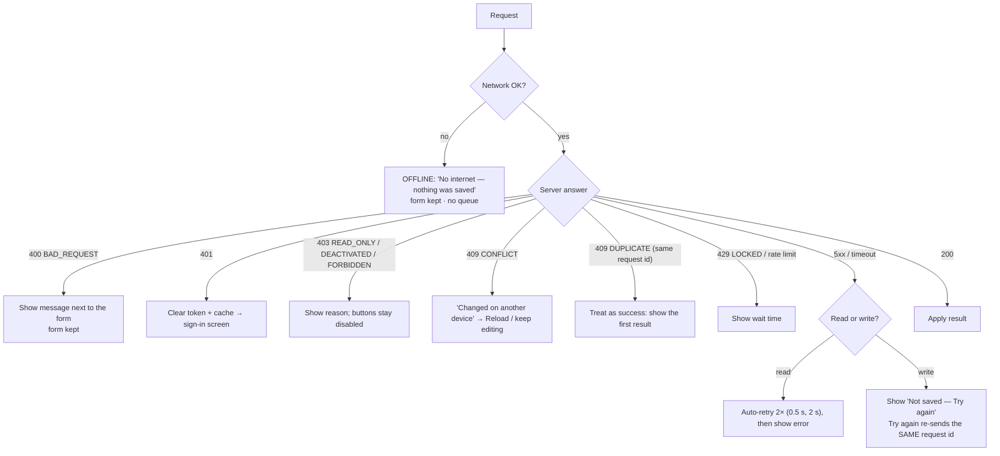
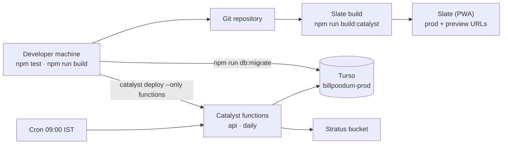
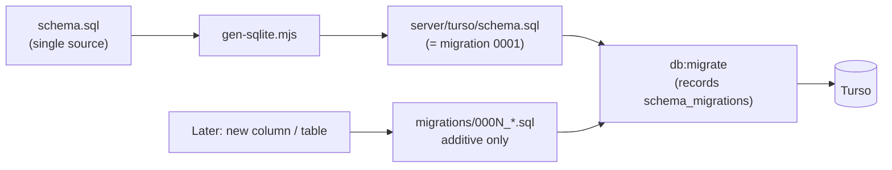
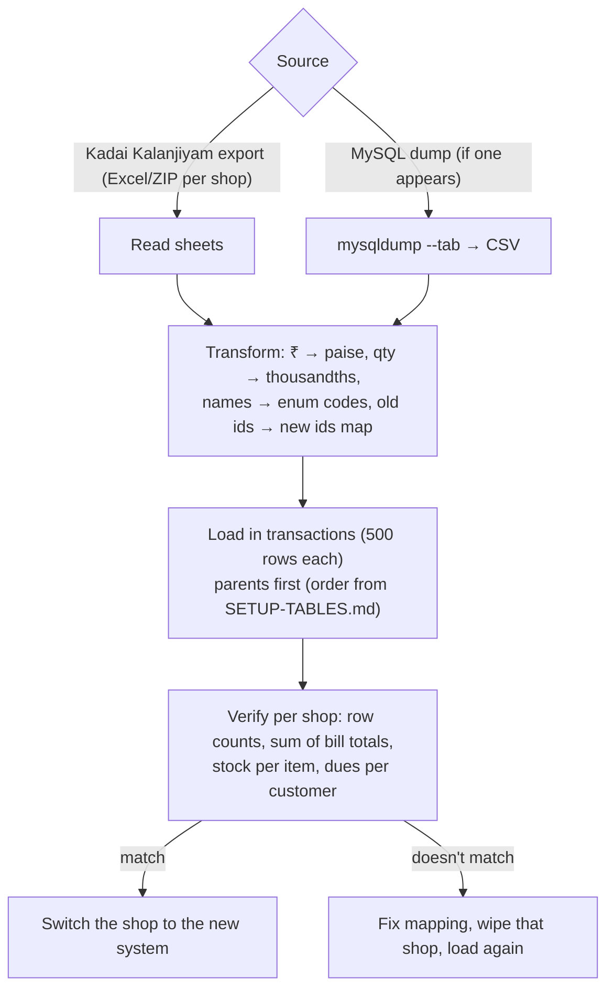

# Kadai Kalanjiyam — Zoho Catalyst + Turso implementation plan

> **Built — see [TURSO.md](TURSO.md) for how it works now.** Main difference from this plan: instead of one database
> for all shops, there is **one platform database + one database per shop** (a shop's billing never waits for another
> shop; SQLite has one writer per database). The rest — transactions, change feed, session epochs, encrypted secrets,
> migrations — was built as planned below.

**Status:** for review — nothing in this plan is implemented yet.
**Date:** 12 Oct 2026 · Related: [schema.sql](schema.sql) · [TABLES.md](TABLES.md) · [CATALYST-TURSO.md](CATALYST-TURSO.md) (costs) · [DEPLOY.md](DEPLOY.md)

---

## 0. Summary

| Decision | Choice |
|---|---|
| Primary database | **Turso** (libSQL / SQLite) — every persistent business record |
| File / image storage | **Catalyst Stratus** |
| Web app (PWA) hosting | **Catalyst Slate** |
| Scheduled tasks | **Catalyst Cron** → Catalyst function `daily` |
| Backend | Existing Node.js API (148 actions) as a **Catalyst Advanced I/O function** `api`; only its database layer changes |
| Catalyst Data Store | Not used (kept as an optional adapter for small installs) |

What changes: one new database adapter (`TursoDb`) with **transactions**, a SQL schema + migrations, a cross-device
change feed for fresher screens, and deployment config. What stays: the 148 API actions and their rules, every
screen, the approved table design, the app's read cache rules, and the demo app.

> **About "migrate the existing MySQL data":** there is no MySQL database in use today. The app runs on the demo
> data in the browser, and the backend has so far only run locally with test data. So there is **no production data
> to migrate yet**. Section 10 covers (a) creating the schema in Turso, and (b) an import tool for any data that
> appears before go-live (the app's own Excel/ZIP export, or a MySQL dump).

---

## 1. Architecture



| Component | Responsibility | Never does |
|---|---|---|
| PWA (Slate) | UI, form validation, keeping unsaved form input, read cache | store pending changes, talk to Turso |
| `api` function | sign-in tokens, tenant / branch / role checks, business rules, pricing, transactions | trust prices, ids or branch from the browser |
| Turso | the only source of truth | — |
| Stratus | image files (≤ 50 KB each + thumbnail), public read | business data |
| `daily` (Cron) | renewal reminders (once per day) | anything triggered by users |

---

## 2. What changes and what stays

| Area | Today (built) | With Turso |
|---|---|---|
| Screens, routes, demo app | unchanged | unchanged |
| API actions & request format | `POST /rpc/<ns>.<method>` | same |
| Business rules (billing, stock, returns, payroll…) | in `backend/src/modules`, `domain` | same code; multi-step writes wrapped in a transaction |
| Database adapter | `CatalystDb` (ZCQL), `MemoryDb` (tests) | + **`TursoDb`** (libSQL). Catalyst adapter kept, not deployed |
| Tables | 57 tables in `schema.sql` | same tables & relations, SQLite DDL generated from `schema.sql` |
| Concurrency | `row_version` retries (no transactions) | SQLite transactions (single writer per database) + `row_version` only where users edit the same record |
| Session cache | Catalyst Cache | function memory + an `epoch` read from Turso (Catalyst Cache GET costs ₹0.0024 each) |
| Cross-device freshness | time-based (15 s – 10 min) | **change feed** every ~15 s (Section 7.3) |
| Tests | in-memory imitation | the real SQLite engine (local file), same as production |

---

## 3. Database design

### 3.1 Tables and relationships

The approved design is kept as-is: **57 tables** in 10 groups, every shop table has `business_id` (tenant key),
branch-level tables also `branch_id`. Purpose of each table and full ER diagrams: [TABLES.md](TABLES.md).

Core sales relationships:



### 3.2 From the schema to SQLite

`backend/scripts/gen-sqlite.mjs` reads `schema.sql` and writes [`server/turso/schema.sql`](../turso/schema.sql) (57 tables + 3 new, 166 indexes, `STRICT` tables, `updated_at` triggers). It is the first migration.

| `schema.sql` | SQLite column | Notes |
|---|---|---|
| `ROWID` (Catalyst system PK) | `id INTEGER PRIMARY KEY` | Shown to the code as `ROWID` by the adapter, so no business code changes. Ids are numbers < 2⁵³. |
| `CREATEDTIME`, `MODIFIEDTIME` | `created_at`, `updated_at` TEXT (ISO-8601 UTC) | Defaults on insert; a trigger updates `updated_at` on every update |
| `VARCHAR(n)` | `TEXT` | Max length checked by the API (as now) — no `CHECK`, so a length can grow later without rebuilding the table |
| `TEXT` | `TEXT` | |
| `INT`, `BIGINT` | `INTEGER` | money in paise, qty in thousandths, % in basis points — unchanged |
| `BOOLEAN` | `INTEGER` 0/1 + `CHECK (col IN (0,1))` | |
| `DATE` / `DATETIME` | `TEXT` `YYYY-MM-DD` / ISO-8601 UTC | Sort and compare correctly as text |
| `ENCRYPTED` (secrets) | `TEXT` holding **AES-256-GCM ciphertext** | Encrypted in the function with `SECRETS_KEY`; Turso never sees the plain token |
| `FK → x CASCADE / NULL` | `REFERENCES x(id) ON DELETE CASCADE / SET NULL` | `PRAGMA foreign_keys = ON` on every connection |
| `UNIQUE` | `UNIQUE` | `uniq_key` columns kept for compatibility; composite `UNIQUE(...)` indexes added where clearer |
| `NOT NULL`, `DEFAULT` | same | |
| Enums (INT codes) | `INTEGER` + `CHECK (col >= 1)` | Numbers from `enums.ts`, never renumbered; checked fully by the API, so a new value needs no migration |

### 3.3 Indexes (keep "rows read" low)

Turso counts **rows scanned**, so every common query gets an index. Main ones:

| Table | Index | Used by |
|---|---|---|
| `orders` | `(business_id, branch_id, status, created_at)` · `(business_id, billed_at)` · `(business_id, customer_id, status)` · `UNIQUE(invoice_key)` · `UNIQUE(client_uuid)` | running orders, reports, dues, idempotency |
| `order_items` | `(order_id)` · `(product_id)` | bill lines, top items |
| `payments` | `(business_id, branch_id, created_at)` · `(order_id)` | payments list, reports |
| `branch_stock` | `UNIQUE(branch_id, product_id)` | stock |
| `stock_movements` | `(business_id, product_id, created_at)` | history |
| `stock_batches` | `(product_id, branch_id, expiry_date)` | first-expiry-first-out |
| `products` | `(business_id, is_active)` · `UNIQUE(barcode_key)` | catalogue, scan |
| `customers` | `UNIQUE(phone_key)` · `(business_id)` | lookup |
| `kitchen_tickets` | `(business_id, branch_id, status)` | kitchen screen |
| `audit_logs`, `admin_audit_logs` | `(business_id, created_at)` | audit views |
| `change_log` (new) | `(business_id, id)` | change feed |

### 3.4 New tables (additions only — nothing existing changes)

| Table | Why |
|---|---|
| `schema_migrations(version, applied_at)` | which migration files have run |
| `change_log(id, business_id, branch_id, tag, at)` | cross-device change feed (Section 7.3); pruned after 2 days |
| `sync_epochs(business_id, epoch)` | invalidates the per-function session cache (replaces Catalyst Cache) |

### 3.5 Tenancy

**One Turso database for all shops**, isolated by `business_id` in every query (as today). A database per shop is
possible later for very large customers (Turso allows unlimited databases on paid plans); the adapter takes the
database URL per business, so this can be added without code changes in the modules.

---

## 4. API design

Unchanged from what is built — so the screens don't change.

| | |
|---|---|
| Endpoint | `POST /server/api/rpc/<namespace>.<method>` body `{ "args": [...] }` |
| Success | `200 { "data": …, "effects"?: { "stock": [...] }, "changes"?: <feed cursor> }` |
| Error | `4xx/5xx { "error": { "message": "<shown to the user>", "code": "<CODE>" } }` |
| Headers | `Authorization: Bearer <token>` · `x-branch: <branch id \| all>` · `x-request-id: <uuid>` (idempotency) · `x-api-version: 1` |
| Auth | customer token (`t:'u'`, 12 h) · admin token (`t:'a'`, 8 h) · support-view token (read-only, 2 h) |
| Other routes | `GET /health` · `GET /schema-check` (setup key) · `POST /rpc/system.runDailyJobs` (cron key) |

Action groups (148): auth 6 · business 3 · branches 4 · roles 3 · users 2 · categories 3 · products 4 · media 1 ·
specials 2 · customers 4 · orders 12 · payments 1 · kitchen 2 · tables 4 · qr 4 · public 4 · expenses 3 ·
inventory 4 · reports 3 · audit 1 · returns 4 · staff 8 · support 6 · campaigns 4 · whatsapp 12 · dataExport 1 ·
system 1 · admin 42.

Error codes the app handles: `BAD_REQUEST` (validation) · `UNAUTHORIZED` (sign in again) · `FORBIDDEN` ·
`READ_ONLY` · `DEACTIVATED` · `SUPPORT_VIEW` · `NOT_FOUND` · `CONFLICT` (changed elsewhere) · `DUPLICATE` ·
`LOCKED` (too many wrong passwords) · `OFFLINE` (client side) · `SERVER_ERROR`.

**Contract rule for new features:** a new action is added in three places — backend module (`define()`), the mock
(`src/data/api.ts`, keeps the demo working) and the cache policy (`src/data/remote/policy.ts`). A test checks that
every mock action has a backend handler.

---

## 5. Backend internals

### 5.1 Database adapter

```ts
interface Db {                                   // existing — modules already use it
  select / first / get / count / aggregate
  insert / insertMany / update / updateMany / delete / deleteMany
  updateIfVersion(table, id, version, patch)     // optimistic edit check
  transaction<T>(fn: (tx: Db) => Promise<T>): Promise<T>   // NEW — all or nothing
}
```

- `TursoDb` uses `@libsql/client` over HTTPS. A transaction is sent as one interactive transaction
  (`BEGIN IMMEDIATE … COMMIT`); several independent reads are sent as one **batch** (one network round trip).
- `MemoryDb` stays for unit tests; integration tests run on a local libSQL **file** (same engine as production).
- `CatalystDb` stays (its `transaction()` runs the steps in order — current behaviour).

### 5.2 Transactions in the business flows

| Flow | In one transaction |
|---|---|
| Checkout / settle | next order + bill number, order row, lines, add-ons, payments, credit-note use, stock out, batches, history, GST break-up, audit |
| Cancel | status, void payments, stock back, KOTs, tables |
| Return / exchange | return + lines, due adjust, refund / credit note, stock back |
| Collect due | allocations across bills + payments |
| Stock adjust / write-off | batch, branch stock, movement, purchase expense |
| Salary / advance | salary row, expense, advance settlement |
| Create customer (admin) | business, branch, roles, permissions, tax rates, owner, subscription period |

The retry / "undo on failure" code written for the Catalyst Data Store becomes unnecessary in these flows.

### 5.3 Concurrency

- **Counters billing at the same time:** SQLite allows one writer at a time per database; transactions queue for a few
  milliseconds. Bill numbers and stock can't collide.
- **Two people editing the same record** (product, customer, settings): the save carries the `row_version` it was
  loaded with; if someone saved first the server returns `409 CONFLICT` and the screen offers to reload. Today these
  edits are last-write-wins; this is an addition.
- **Same request sent twice** (double tap, network retry): `x-request-id` → `client_uuid` UNIQUE → the first result is
  returned, nothing is created twice.

### 5.4 Session cache

Per function instance: `Map<token, session>` for 60 s, keyed with the business `epoch` (one indexed read per
request from `sync_epochs`). Any change to users, roles, branches, settings or features increments the epoch.

---

## 6. Read and write flows

### 6.1 Read



### 6.2 Write (add / update / delete)

```mermaid
sequenceDiagram
  autonumber
  participant UI as Screen
  participant RC as Read cache
  participant API as Catalyst api
  participant DB as Turso
  UI->>UI: validate form, disable Save, show "Saving…"
  UI->>API: POST /rpc/products.save (+ x-request-id)
  API->>API: auth · tenant · branch · read-only · permission · validation
  API->>DB: BEGIN; writes…; COMMIT
  alt committed
    DB-->>API: ok
    API->>DB: insert change_log (tag, business, branch)
    API-->>UI: data (+ effects)
    UI->>RC: apply effects, drop affected tags
    RC->>API: re-fetch the screens that are open (only them)
    UI->>UI: show saved result, close form
  else failed (rolled back)
    DB-->>API: error
    API-->>UI: error { message, code }
    UI->>UI: show message, keep the form as typed, enable Save
  end
```

Rules (from the requirements, enforced in code):
1. Nothing is shown as saved and nothing is written to local state before the server answers `200`.
2. No optimistic updates; no offline queue; no pending changes in localStorage / IndexedDB / cache.
3. After success the affected reads are refreshed from the database; untouched reads are reused.

---

## 7. State management (app)

### 7.1 Layers

| Layer | Holds | Lifetime |
|---|---|---|
| Form state (React) | what the user is typing | until saved or closed — kept on errors |
| Read cache (`src/data/remote/cache.ts`) | server-confirmed results of reads, with tags | memory only; cleared on sign-out / branch switch / refresh |
| Change bus (`subscribe` / `notify`) | "something changed" → open screens re-read | — |
| Persistent | sign-in tokens and chosen branch **only** | localStorage |

### 7.2 One read's life



### 7.3 Changes made on other devices — change feed

Today another counter's changes appear after 15 s – 10 min (time-based). Planned:



- One small indexed read every 15 s per device (instead of re-reading lists on a timer).
- Tags are the same ones the cache already uses (`orders`, `catalog`, `stock`, `customers`, …).
- Max-age timers stay as a safety net, but much longer (e.g. 30 min).

---

## 8. Error handling

### 8.1 Where each error is handled



### 8.2 Retries

| Where | Rule |
|---|---|
| App, reads | automatic retry 2× with back-off; reads are safe to repeat |
| App, writes | **no automatic retry**; "Try again" button re-sends with the same `x-request-id`, so a write that actually reached the database before the network dropped is not done twice |
| Server → Turso | a transaction that fails with a temporary error (busy, network) is retried as a whole up to 3× — safe, because a failed transaction leaves nothing behind |
| Cron job | runs at most once per day (`lastRunOn`), each customer at most one reminder per day |

### 8.3 Partial failures

| Case | Result |
|---|---|
| Turso fails in the middle of a bill | transaction rolls back — no bill, no payment, no stock change |
| Photo saved to Stratus but database insert fails | file is orphaned (no data inconsistency); a weekly job deletes files with no `media_files` row |
| Response lost after commit | the retry with the same request id returns the saved bill |
| WhatsApp send fails | message row saved with status `failed`, shown in the message log |

---

## 9. Hosting and deployment



| Environment | Turso database | Catalyst | Web |
|---|---|---|---|
| Local | libSQL file `backend/.local/dev.db` | `npm run dev` (local server) | `npm run dev:catalyst` |
| Development | `billpoodum-dev` | Development environment | Slate preview |
| Production | `billpoodum-prod` | Production environment | Slate production + custom domain |

Function environment variables: `TURSO_DATABASE_URL`, `TURSO_AUTH_TOKEN`, `AUTH_SECRET`, `SECRETS_KEY`,
`SETUP_KEY`, `CRON_KEY`, `STRATUS_BUCKET`, `STRATUS_PUBLIC_URL`, `ALLOWED_ORIGINS`. Never committed to Git.

Backups: Turso point-in-time restore (Free 1 day, Developer 10 days, Scaler 30 days) + a weekly SQL dump to a
private Stratus bucket. Monitoring: Catalyst Logs / APM for the functions; Turso dashboard for rows read/written.

Release steps: tests pass → `db:migrate` (only additive migrations in normal releases) → deploy functions → deploy
Slate → smoke test (`backend/scripts/smoke.mjs`). Rollback: Slate and functions roll back to the previous version;
migrations are additive, so the old code keeps working with the new schema.

---

## 10. Migration strategy

### 10.1 Schema



- Migrations are **additive** (new tables / columns / indexes). Renames and drops happen in two releases
  (add new → move data → stop using old → drop later).
- `/schema-check` keeps comparing the live database with the schema.

### 10.2 Data

There is no live data today, so go-live starts with an empty production database. If data needs importing before
or after go-live:



Tool: `backend/scripts/import.mjs --source <file> --business <id> --dry-run` (dry run prints the counts and totals
without writing).

---

## 11. Testing

| Level | What | Where |
|---|---|---|
| Unit | pricing, totals, payroll, unit conversion, enum mapping | `backend/test`, `MemoryDb` |
| Integration | every action through HTTP on a real libSQL file; transactions roll back on failure | `backend/test` |
| Concurrency | 20 parallel checkouts → unique bill numbers, exact stock | `backend/test` |
| Contract | every mock action has a backend handler, same response shape | script (already exists) |
| UI | main flows in the browser against the local backend | manual + checklist |
| Deployed | `smoke.mjs` against development, then production | after each deploy |
| Load | 10 counters × 1 bill / 5 s for 30 min; check latency and Turso usage | before go-live |

---

## 12. Phases

| Phase | Work | Review point |
|---|---|---|
| 1 | `TursoDb` adapter, SQLite schema generator, migrations, `schema_migrations`, secrets encryption | schema SQL reviewed |
| 2 | Transactions in billing, cancel, returns, dues, stock, payroll, admin create; remove retry/undo code there; concurrency tests | all tests on libSQL |
| 3 | Change feed (`change_log`, `sync.changes`), app polling, longer max-age; `row_version` conflict check on edits; write "Try again" with same request id | demo on two browsers |
| 4 | Session cache in memory + `sync_epochs`; deploy config (env vars, Slate, Cron); smoke + load test | deployed to development |
| 5 | Import tool, backups, monitoring notes, docs | go-live checklist |

---

## 13. Risks and open questions

| # | Item | Proposal |
|---|---|---|
| 1 | Turso region near Catalyst's India DC | confirm at sign-up (Mumbai preferred); measure latency in phase 4 |
| 2 | Catalyst functions calling Turso (outbound HTTPS) | expected to work; verified in phase 4 smoke test |
| 3 | Turso is joining Supabase — pricing may change | data is plain SQLite; the `Db` adapter keeps a move to PostgreSQL / another host small |
| 4 | Single-writer database: very busy peak hours | writes are short transactions (ms); if ever needed, large shops get their own database (Section 3.5) |
| 5 | Edits of the same product on two devices | conflict check (Section 5.3) — confirm you want "reload" rather than last-write-wins |
| 6 | Change-feed interval (15 s) | confirm; shorter = fresher, more reads |
| 7 | Keep the Catalyst Data Store adapter? | keep in code for small installs, not deployed |

**Decisions needed before implementation:** 1) Turso region, 2) conflict behaviour (#5), 3) change-feed interval
(#6), 4) one database for all shops now (recommended) vs one per shop.
