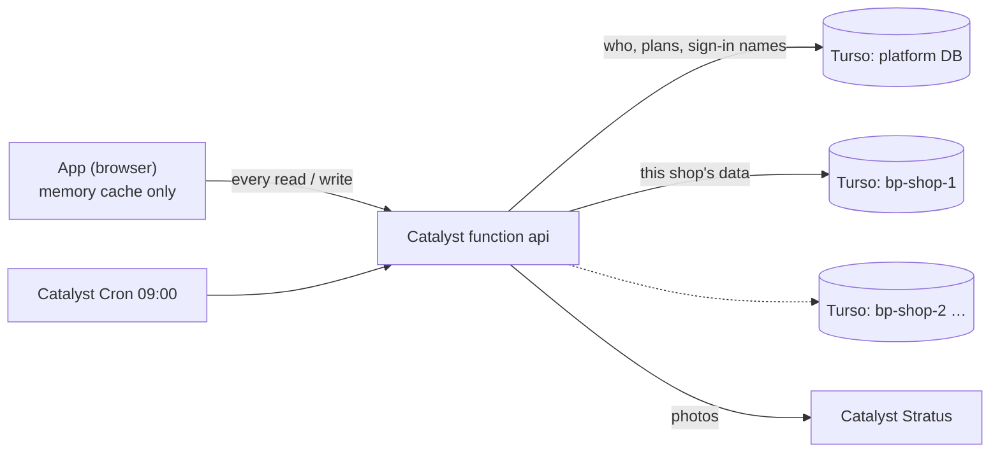
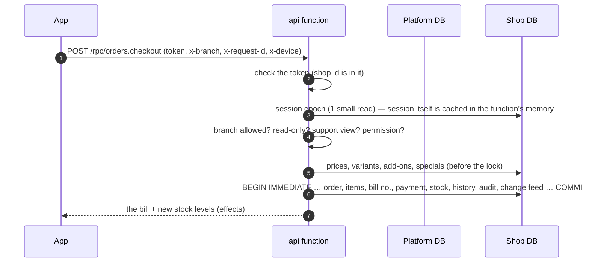

# BillPoodum on Catalyst + Turso — as built

This is how the backend works now. It replaces the design parts of [TURSO-PLAN.md](TURSO-PLAN.md): the plan proposed one
database for all shops, but what was built is **one platform database plus one database per shop**.
Deploy steps are in [DEPLOY.md](DEPLOY.md), and prices in [CATALYST-TURSO.md](CATALYST-TURSO.md).

## 1. Who does what

| Part | Runs on | Holds |
|---|---|---|
| Web app (PWA) | Catalyst **Slate** | built app files |
| API `api` (149 actions) + daily job `daily` | Catalyst **Functions** (+ Cron) | nothing (checks and passes data) |
| Photos, ticket screenshots | Catalyst **Stratus** | image files |
| Platform data | **Turso** — 1 platform database | admins, shop directory, plans, subscriptions, feature flags, support tickets, sign-in names, platform WhatsApp, admin audit |
| Shop data | **Turso** — 1 database **per shop** | branches, users, roles, products, stock, bills, payments, returns, customers, staff, expenses, WhatsApp, audit… |

Each shop has its own database because SQLite allows **one writer at a time per database**. Shops never wait for each
other, and a busy supermarket only slows itself down. Each table's placement is listed in
[`backend/scripts/placement.mjs`](../../backend/scripts/placement.mjs). Four tables exist in both databases:
`media_files`, `secrets`, `whatsapp_templates` and `whatsapp_messages`. The shop's own rows are in the shop database; the platform's rows (business_id NULL, or the product admin's) are in the platform database.

## 2. Schema and migrations

- Single source: `server/catalyst/schema.sql`. Generated output:
  - `server/turso/platform.sql` and `server/turso/shop.sql`, the full current schema of each kind of database.
  - `backend/migrations/<platform|shop>/0001_init.sql`, the first migration.
  - Both are bundled into the API by `migrations.gen.ts`.
- A foreign key is kept only when both tables are in the same database. A reference to the other database is a plain
  INTEGER, checked by the API.
- Ids are `INTEGER PRIMARY KEY AUTOINCREMENT`, so an id is never reused after a delete. The API still calls them
  `ROWID`, `CREATEDTIME` and `MODIFIEDTIME`, so the code works the same on Catalyst.
- **Changing a table:**
  1. Edit `schema.sql`.
  2. Run `npm --prefix backend run gen`.
  3. Write `backend/migrations/<kind>/0002_<what>.sql` (`ALTER TABLE …`).
  4. Deploy.

  Shop databases migrate themselves on their first request after the deploy. To migrate everything at once, `POST /migrate` with the `x-setup-key` header. `0001_init.sql` is never edited after a database exists.
- Turso-only tables:
  - `schema_migrations`
  - `change_log` (the change feed)
  - `sync_epochs` (session freshness)

## 3. A request

- **Transactions.** Every customer write is one transaction on the shop's database (`tx: 'auto'`, the default): all of it
  is saved, or nothing.
  - Billing uses `tx: 'manual'`. It reads prices first, outside the lock, then calls `c.tx()` around the writes.
  - Handlers that call other services (photo upload, WhatsApp, creating databases) use `tx: 'none'` and keep their own
    undo steps.
  - Product-admin writes are one transaction on the platform database.
- **One writer per shop.**
  - A bill holds its shop's lock for about 16 round trips to Turso. The test suite checks this stays ≤ 18.
  - The stock of all plain items moves in one statement batch, and bill numbers are taken in one `UPDATE … RETURNING`.
  - If another counter holds the lock, the API waits and retries for up to 8 s. After that it answers `BUSY`, and the app
    retries once with the same `x-request-id`. Bills, payments and returns are saved at most once per id.
- **Two databases, no shared transaction.** Some changes cover both, such as sign-in names (platform) plus the user row
  (shop). They are ordered so a stop half-way is always safe:
  - A new name is claimed before the user row uses it.
  - If the request fails, the claim is undone (`c.onFail`).
  - The old name is released only after the commit (`c.afterCommit`).
  - The daily job removes claims left by a save that never finished.
- **Sessions.**
  - Cached in each function instance's memory, keyed by the shop's epoch (`sync_epochs`) and a global epoch (platform
    setting, re-read every 30 s).
  - Any change to users, roles, branches, settings, the subscription or features raises the epoch, so stale copies are
    never used.
  - Admins are read fresh on every request.

## 4. The app's state

- Reads are cached in memory only (`src/data/remote/cache.ts`). Writes go to the server first, and the screen changes only
  after it confirms. Nothing is stored offline or queued.
- **Change feed** (`src/data/remote/sync.ts` ↔ `sync.changes`):
  - Every committed write adds its action name to the shop's `change_log`, in the same transaction.
  - Each device asks every 30 s, but only while the tab is on screen and was used in the last 5 minutes: "what changed
    since id n?"
  - It then drops just the cached reads those actions affect, using the same rules as its own writes (`policy.ts`).
  - A device's own changes are left out (`x-device`). Sign-ins and uploads are not in the feed.
  - When the session epoch changes, the app reloads "me" (subscription, permissions).
  - While the feed runs, cached reads are trusted 4× longer (up to 30 min). On the Catalyst Data Store there is no feed,
    and the normal times apply.
  - Rows older than 2 days are removed as new ones are written.

## 5. Security

- The browser never talks to Turso: the token stays in the function's settings.
- Every value is a query parameter, and every table and column name is checked against the schema.
- A query on the wrong database is refused (`scoped()` handles). The tests cover every action in all three setups.
- WhatsApp access tokens are encrypted with **AES-256-GCM** before they reach the database (`SECRETS_KEY`). Catalyst
  encrypts by itself.
- Sign-in: usernames, mobiles and emails are unique across every shop (`login_names`). Wrong passwords lock the login
  for 15 minutes after 5 tries, and an unknown name takes as long to answer as a wrong password.
- Deleting a customer removes its whole database. Signed-in devices of that shop are signed out on their next request.

## 6. Running it

| Where | Databases | Command |
|---|---|---|
| Production | Turso (Hrana over HTTPS, plain `fetch`, no packages) | `catalyst deploy` (see DEPLOY.md) |
| Your computer | SQLite files in `backend/.local/sqlite/` (sql.js), same layout | `npm --prefix backend run dev` |
| Tests | every test 3×: in-process SQLite · over HTTP against a stand-in Turso server · single in-memory DB (Catalyst rules) | `npm --prefix backend test` |

`DB` choice in the function: `TURSO_PLATFORM_URL` set → Turso; not set → the Catalyst Data Store (the first version, one
database).

## 7. Later, if needed (the design allows it)

- **Move a shop between Turso and Catalyst, or put several shops in one database.** Every shop row keeps its
  `business_id`. Only the shop directory (`shop_databases`) says where a shop lives. A copy tool reads one shop's tables
  and writes them elsewhere.
- **Archive old stock history** to a file to keep storage low.
- **Live Turso check.** Run `backend/scripts/smoke.mjs` against the deployed API. The stand-in server follows the
  documented protocol, but only the real Turso proves it.
